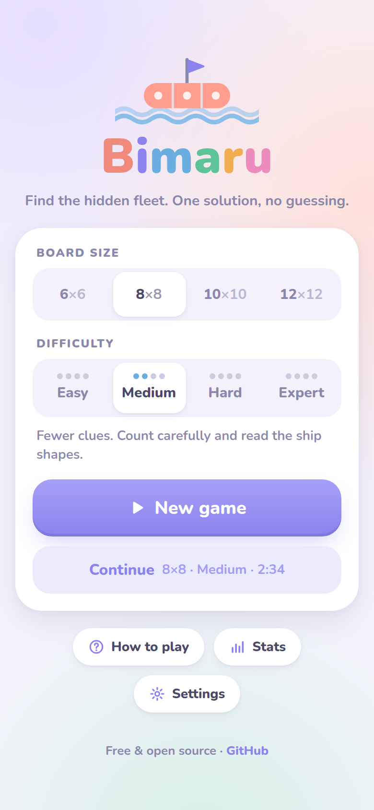
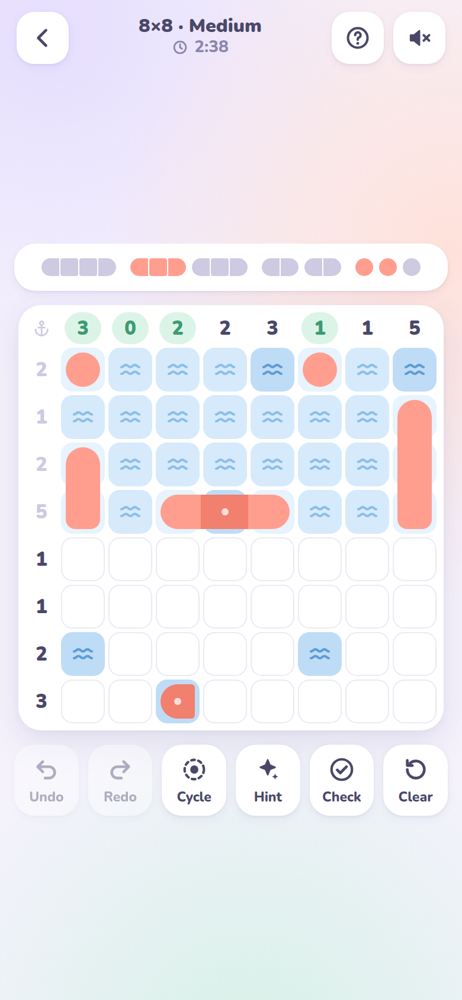
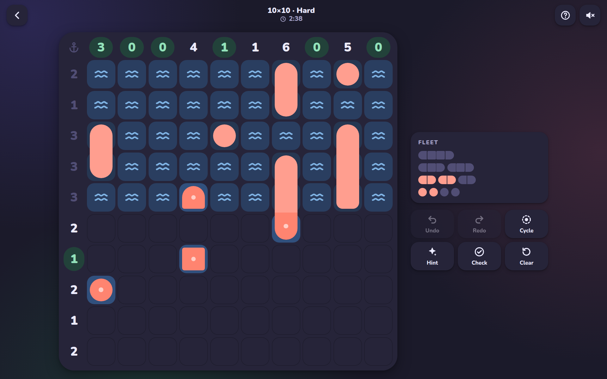

# Bimaru

A calm, open-source **Bimaru** (battleship solitaire) puzzle for phones and laptops.
Pick a board size and a difficulty, then find the hidden fleet. Every puzzle has exactly
one solution and can be solved by logic alone, with no guessing.

### ▶ [Play it in your browser](https://graphoflife.github.io/Bimaru/)

<p align="center">
  
  &nbsp;
  
</p>
<p align="center">
  
</p>

## Features

- **4 board sizes** (6×6, 8×8, 10×10, 12×12) and **4 difficulties** (Easy, Medium, Hard, Expert)
- **Endless puzzles**, generated on your device in milliseconds, each with a unique solution
- **Phone and laptop**: touch, mouse and keyboard; installable as an app (PWA) and works offline
- **Pastel light and dark themes** with smooth animations; ship pieces morph into shape as you play
- **Satisfying sounds**, synthesized live with the Web Audio API (no audio files), plus light haptics on supported phones
- Undo and redo, hints that point at the next logical step, mistake check, autosave, stats and best times
- Share a puzzle with a link
- No tracking, no ads, no build step, no dependencies

## How to play

1. A fleet of ships is hidden in the grid. The fleet is shown above the board, or beside it on wide screens.
2. The numbers tell you how many ship segments are in each row and column.
3. Ships are straight lines and never touch each other, not even diagonally.
4. Some cells are given. A rounded end shows which way a ship continues, a square piece is a middle part and a circle is a one-cell submarine.

### Controls

| Action | Phone | Laptop |
| --- | --- | --- |
| Cycle a cell: water → ship → empty | Tap | Click (right-click cycles backwards) |
| Paint many cells | Drag | Drag |
| Fill the rest of a finished row or column | Tap its number | Click its number |
| Place only water or only ships | Switch the **Cycle** tool | Same, or press `M` |
| Move and mark | | Arrow keys, `Space`, `W`, `S`, `Backspace` |
| Undo / redo | Tool buttons | `Ctrl+Z` / `Ctrl+Y` |
| Hint | Tool button | `H` |

### Difficulty levels

Difficulty is defined by the reasoning a puzzle needs, not only by the number of clues:

| Level | What you need |
| --- | --- |
| Easy | Row and column counts plus ship shapes, with extra clues |
| Medium | The same techniques, with as few clues as possible |
| Hard | Fleet reasoning: where can the remaining big ships still fit? |
| Expert | One-step "what if" reasoning: assume a cell, follow the consequences, find a contradiction |

## Run it locally

There is no build step. Clone the repository and open `index.html`, or serve the folder:

```bash
git clone https://github.com/graphoflife/Bimaru.git
cd Bimaru
python3 -m http.server 8000
```

Then open <http://localhost:8000>.

Run the tests (Node 18 or newer):

```bash
npm test
```

## How the puzzles are made

The generator lives in [`js/engine.js`](js/engine.js):

1. Place the fleet at random so that no two ships touch.
2. Run a human-style logical solver that may only use the techniques allowed for the chosen difficulty. Wherever it gets stuck, reveal one cell of the solution as a clue, then try again until it can finish the board.
3. Try removing each clue and keep the removal if the puzzle is still solvable.
4. For Hard and Expert, prefer puzzles that the next easier solver cannot finish.

The solver only makes sound deductions, so finishing the board proves that the solution is unique.
The test suite double-checks this with an independent brute-force solver.

## Project layout

```text
index.html        markup and the SVG icon sprite
css/style.css     light/dark theme tokens, layout, animations
js/engine.js      puzzle generator and solver (also runs in Node)
js/app.js         game UI, input, saving, stats
js/audio.js       Web Audio synthesizer for every sound
js/fx.js          confetti, bubbles and sparkles on a canvas
sw.js             offline cache
test/             node:test suite
```

## Contributing

Issues and pull requests are welcome. Please run `npm test` before opening a pull request.
Some ideas: a daily puzzle, more board sizes, translations.

## License

The code is released under the [MIT License](LICENSE).
The [Nunito](https://github.com/googlefonts/nunito) font is licensed under the SIL Open Font License ([`fonts/OFL.txt`](fonts/OFL.txt)).
