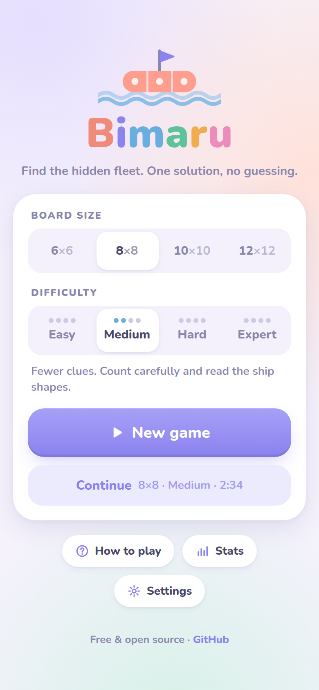
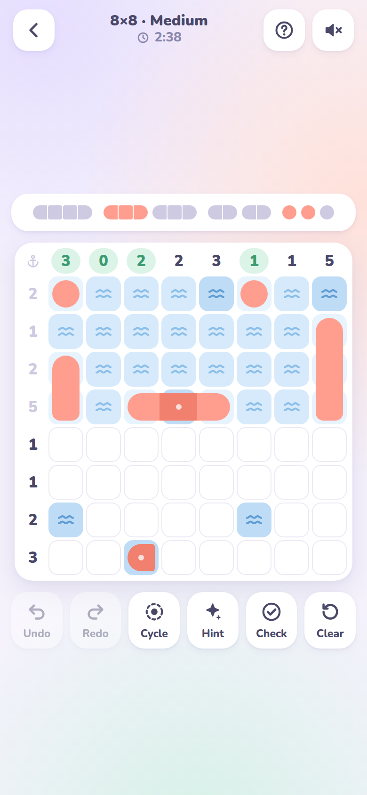
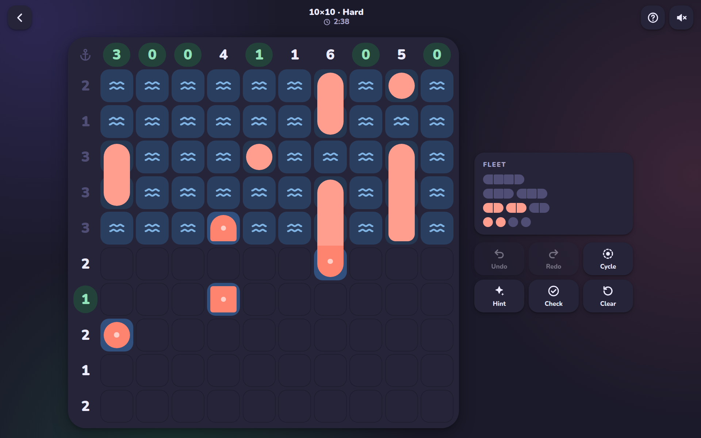

# Bimaru

A calm, open-source **Bimaru** (battleship solitaire) puzzle for phones and laptops.
Pick a board size and a difficulty, then find the hidden fleet. Every puzzle has exactly
one solution and can be solved by logic alone, with no guessing.

### ▶ [Play it in your browser](https://graphoflife.github.io/Bimaru/)

<p align="center">
  
  &nbsp;
  
</p>
<p align="center">
  
</p>

## Features

- **5 board sizes** (6×6 to 15×15) with growing fleets and **4 difficulties** (Easy, Medium, Hard, Expert)
- **Endless puzzles**, generated on your device in milliseconds, each with a unique solution
- **Phone and laptop**: touch, mouse and keyboard; installable as an app (PWA) and works offline
- **Pastel light and dark themes** with smooth animations; ship pieces morph into shape as you play
- **Satisfying sounds**, synthesized live with the Web Audio API (no audio files), plus light haptics on supported phones
- **Never a guess**: from any position there is a next move you can prove, and Hint shows it with a short explanation
- Undo and redo, mistake check, autosave, stats and best times
- Share a puzzle with a link
- No tracking, no ads, no build step, no dependencies

## How to play

1. A fleet of ships is hidden in the grid. The fleet is shown above the board, or beside it on wide screens.
2. The numbers tell you how many ship segments are in each row and column.
3. Ships are straight lines and never touch each other, not even diagonally.
4. Some cells are given. A rounded end shows which way a ship continues, a square piece is a middle part and a circle is a one-cell submarine.

### Controls

| Action | Phone | Laptop |
| --- | --- | --- |
| Cycle a cell: water → ship → empty | Tap | Click (right-click cycles backwards) |
| Paint many cells | Drag | Drag |
| Fill the rest of a finished row or column | Tap its number | Click its number |
| Place only water or only ships | Switch the **Cycle** tool | Same, or press `M` |
| Move and mark | | Arrow keys, `Space`, `W`, `S`, `Backspace` |
| Undo / redo | Tool buttons | `Ctrl+Z` / `Ctrl+Y` |
| Hint | Tool button | `H` |

### Boards and fleets

Bigger boards hide more ships and longer ships. Most fleets follow the triangular pattern common in
published Bimaru puzzles: one ship of the longest length, two of the next length, and so on.

| Board | Ships | Ship cells | Longest ship | Fleet (count × length) |
| --- | --- | --- | --- | --- |
| 6×6 | 6 | 10 | 3 | 1×3, 2×2, 3×1 |
| 8×8 | 8 | 17 | 4 | 1×4, 2×3, 2×2, 3×1 |
| 10×10 | 10 | 20 | 4 | 1×4, 2×3, 3×2, 4×1 |
| 12×12 | 15 | 35 | 5 | 1×5, 2×4, 3×3, 4×2, 5×1 |
| 15×15 | 21 | 56 | 6 | 1×6, 2×5, 3×4, 4×3, 5×2, 6×1 |

The fleets up to 12×12 are ones used in the [Janko.at puzzle archive](https://www.janko.at/Raetsel/Battleships/index.htm).
The 15×15 fleet is this game's own next step in the pattern, at about the same density as Janko's
12×12 and 14×14 boards. Other sites differ at this size: [puzzle-battleships.com](https://www.puzzle-battleships.com/)
keeps the 12×12 fleet on 15×15 and only adds longer ships on its 20×20 boards and up.

### Difficulty levels

Difficulty is defined by the techniques a puzzle needs, not only by the number of clues. The techniques
come from published Bimaru guides ([Conceptis](https://www.conceptispuzzles.com/index.aspx?uri=puzzle/battleships/techniques),
[Wikipedia](https://en.wikipedia.org/wiki/Battleship_(puzzle)), [Luke Rissacher](https://lukerissacher.com/battleships),
[puzzles.wiki](https://www.puzzles.wiki/wiki/Battleship_(logic_puzzle))). Which technique belongs to which level is this game's own design.

| Level | Techniques | Hard moments per puzzle |
| --- | --- | --- |
| Easy | **Corners**, **Given piece**, **The rest is water**, **Only spots left**. Extra clues. | None |
| Medium | The same techniques, with as few clues as possible | None |
| Hard | Plus **Only place it fits**, **Overlap**, **One way only**, **No ship fits here**, **Finish the ship**, **Finish the line** | 2–3 on 6×6, up to 4–9 on 15×15 |
| Expert | Plus **What if?** | The above, plus 1–2 what-ifs on 6×6, up to 2–5 on 15×15 |

### Fair by design

Every technique is kept at a size a person can follow:

- **Fleet techniques** compare at most 7 positions and fit at most 3 ships of a type together.
- **Finish the line** only looks at nearly complete rows and columns (at most 2 ship segments or water cells left) with at most 6 ways to finish.
- **What if?** only tests cells in rows and columns with at most 4 open cells, and follows the assumption locally: its corners, the given pieces it touches, its own row and column, and the corners of what those force.
- **Limits per puzzle:** if a puzzle needs too many hard moments, or a what-if is too hidden (more than 12 tries per assumption that works), the generator adds a clue there.

### No guessing, guaranteed

A puzzle only ships if the solver can finish it using the techniques of its level, so you never need
to guess. This holds from *any* position, not only from the start: whatever correct marks you have
made, in whatever order, a provable next move exists. The test suite checks exactly that by starting
from random partial boards and following hints to the end.

The **Hint** button uses the same techniques. It always reveals a cell that can be proven from what
you already have on the board, names the technique and tells you why ("Row 4 already has all 3 ship
segments, so the rest of it is water"). For an Expert "what if" step it plays the proof on the board:
the assumption, what it forces, and what breaks.

## Run it locally

There is no build step. Clone the repository and open `index.html`, or serve the folder:

```bash
git clone https://github.com/graphoflife/Bimaru.git
cd Bimaru
python3 -m http.server 8000
```

Then open <http://localhost:8000>.

Run the tests (Node 18 or newer):

```bash
npm test
```

## How the puzzles are made

The generator lives in [`js/engine.js`](js/engine.js):

1. Place the fleet at random so that no two ships touch.
2. Run a human-style logical solver that may only use the strategies allowed for the chosen difficulty. Wherever it gets stuck, reveal one cell of the solution as a clue, then try again until it can finish the board.
3. Try removing each clue and keep the removal if the puzzle is still solvable.
4. For Hard and Expert, prefer puzzles that the next easier solver cannot finish.

The solver only makes sound deductions, so finishing the board proves that the solution is unique.
The test suite double-checks this with an independent brute-force solver.

## Project layout

```text
index.html        markup and the SVG icon sprite
css/style.css     light/dark theme tokens, layout, animations
js/engine.js      puzzle generator and solver (also runs in Node)
js/app.js         game UI, input, saving, stats
js/audio.js       Web Audio synthesizer for every sound
js/fx.js          confetti, bubbles and sparkles on a canvas
sw.js             offline cache
test/             node:test suite
```

## Contributing

Issues and pull requests are welcome. Please run `npm test` before opening a pull request.
Some ideas: a daily puzzle, more board sizes, translations.

## License

The code is released under the [MIT License](LICENSE).
The [Nunito](https://github.com/googlefonts/nunito) font is licensed under the SIL Open Font License ([`fonts/OFL.txt`](fonts/OFL.txt)).
